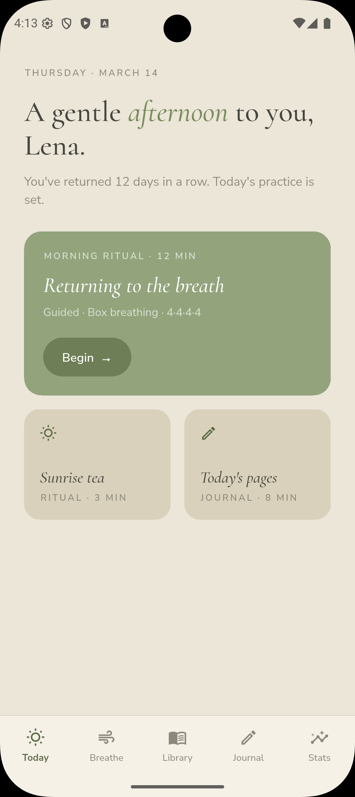
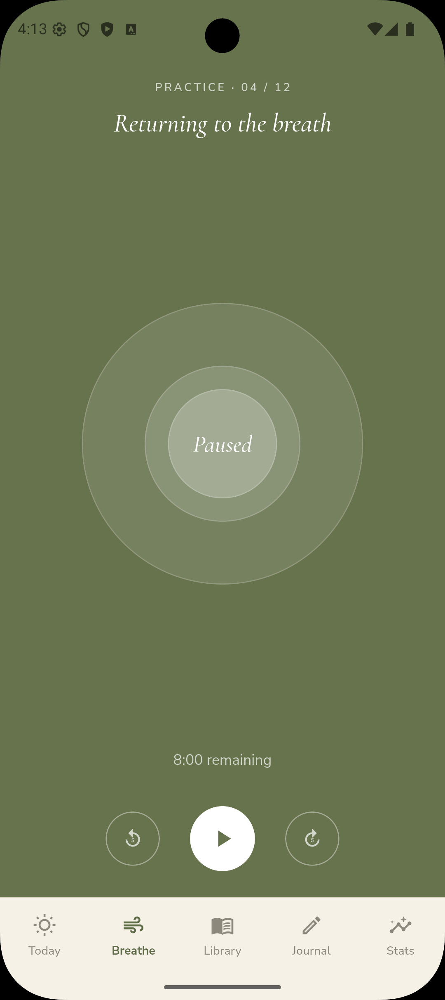
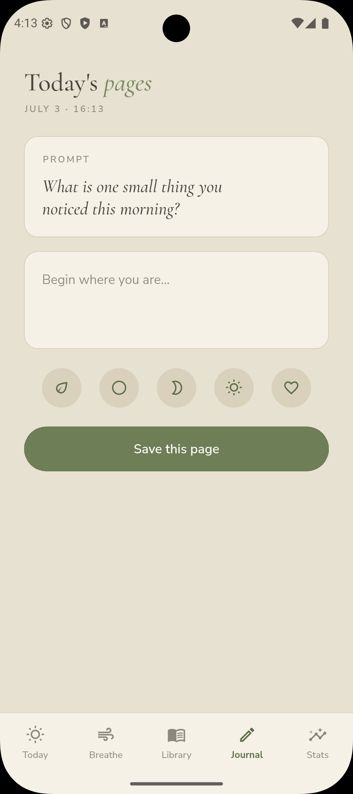

# Stillwater

**A quieter way to be well.**

Stillwater is a soft-wellness app that treats stillness like an art — minimal,
unhurried, and deeply considered. No streaks shouted, no metrics pushed; only
small returns. Built with Flutter.

---

## Screenshots

<p align="center">
  
  
  
</p>

<p align="center"><em>Today · Breathe · Journal</em></p>

> To display these, add the three screenshots to `docs/screenshots/` named
> `today.png`, `breathe.png`, and `journal.png`.

---

## Features

Five screens, tied together by a single in-memory state so the app feels alive —
a finished breathing session adds to your total time, a saved journal entry adds
a page, and the week quietly fills in.

- **Today** — a time-of-day greeting, the day's set practice, and quick rituals.
  *Begin* opens the breath session; the tiles toggle done or jump to your pages.
- **Breathe** — a working box-breathing engine (4·4·4·4). The rings expand and
  contract with each phase, with a live countdown, play/pause, and ±5s skips.
  Finishing a session records the time you practiced.
- **Library** — a curated collection with working filters
  (All · Breath · Sleep · Walks · Reading). Tap any practice to open its detail
  sheet and begin.
- **Journal** — a daily prompt, a real writing field, a selectable mood, and a
  *Save this page* action. Saved entries appear beneath, timestamped.
- **Stats** — gentle metrics that update from what you actually do: days
  returning, total time, pages written, and a soft weekly ring.

---

## Design

- **Concept** — stillness as a practice, not a productivity contest.
- **Palette** — warm cream, sage, deep forest green, with a muted mauve accent.
- **Type** — *Cormorant* (expressive serif, used in italic for warmth) paired
  with *Nunito Sans* (calm, legible body and tracked-out labels), via
  [`google_fonts`](https://pub.dev/packages/google_fonts).

---

## Architecture

State lives in a single `ChangeNotifier` shared through an `InheritedNotifier`,
so every screen reads and writes the same source of truth without any external
state-management package.

```
lib/
├── main.dart                # App shell, bottom navigation, tab background moods
├── state/
│   └── app_state.dart       # AppState (ChangeNotifier) + AppScope (InheritedNotifier)
├── theme/
│   └── app_theme.dart       # AppColors + AppText (typography helpers)
├── data/
│   └── practices.dart       # Library content + filter categories
├── widgets/
│   └── soft_image.dart      # Asset image with a graceful fallback tile
└── screens/
    ├── today_screen.dart
    ├── breathe_screen.dart
    ├── library_screen.dart
    ├── journal_screen.dart
    └── stats_screen.dart
```

---

## Getting started

```bash
git clone https://github.com/HibaChamkhi/Stillwater.git
cd Stillwater
flutter pub get
flutter run
```

Requires the Flutter SDK (stable channel). The app runs on iOS, Android, web,
and desktop.

### Image assets

Three photos power the Library and Today cards. Drop them into
`assets/images/` with these exact names (any missing file falls back to a soft
tinted tile, so the app always runs):

| Filename              | Photo                       |
|-----------------------|-----------------------------|
| `morning_tea.jpg`     | Green tea cup on linen       |
| `notes_stillness.jpg` | Dried grass in a vase        |
| `forest_dawn.jpg`     | Foggy bamboo forest path     |

---

## Notes

- State is in-memory for now — data resets on relaunch. Persistence
  (`shared_preferences` or a local database) is the natural next step.
- The breathing audio and soundscapes are represented visually; wiring real
  audio is a good future addition.

---

*A small practice.*
